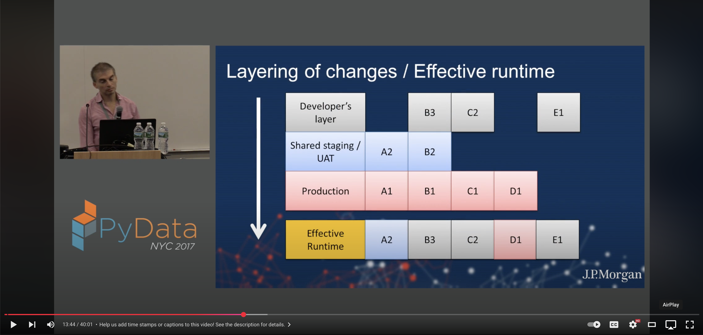

# fsspec-union

Look up paths across ordered fsspec filesystems.

`fsspec-union` combines path-existence and metadata lookup across an ordered set
of backends. The first backend containing a path determines its metadata and kind.
Ordinary delegated operations, including listing and `open`, currently use the
first backend exposing that method. There is no read-through cache or copy-up.

## Documentation

[Look up files in two directories](docs/tutorial.md) builds a local union and
checks path precedence. [Configure union roots](docs/how-to-configure.md) covers
chained URLs and cleanup. The [reference](docs/reference.md) lists lookup and
method-delegation behavior; [Ordered lookup and delegation](docs/explanation.md)
explains the distinction.

The [project talk](https://youtu.be/M9o9SF5-Pzw?t=824) introduces the original use case.

